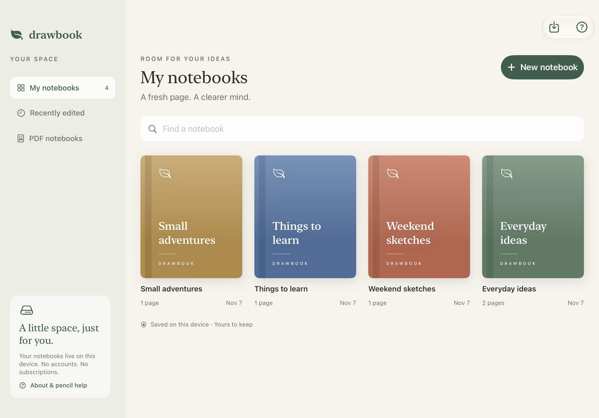
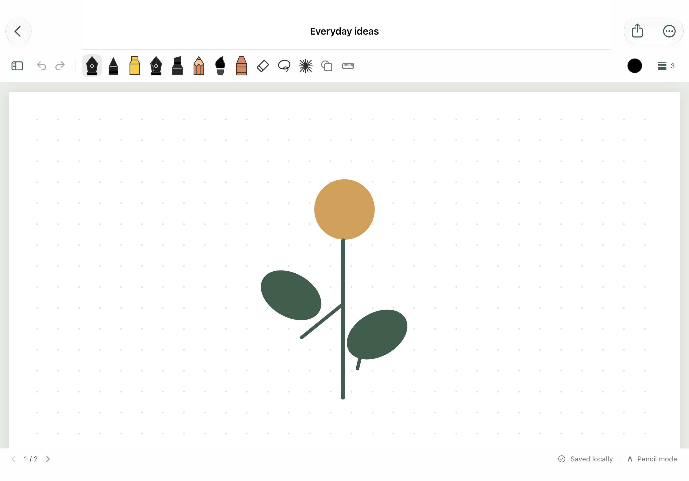
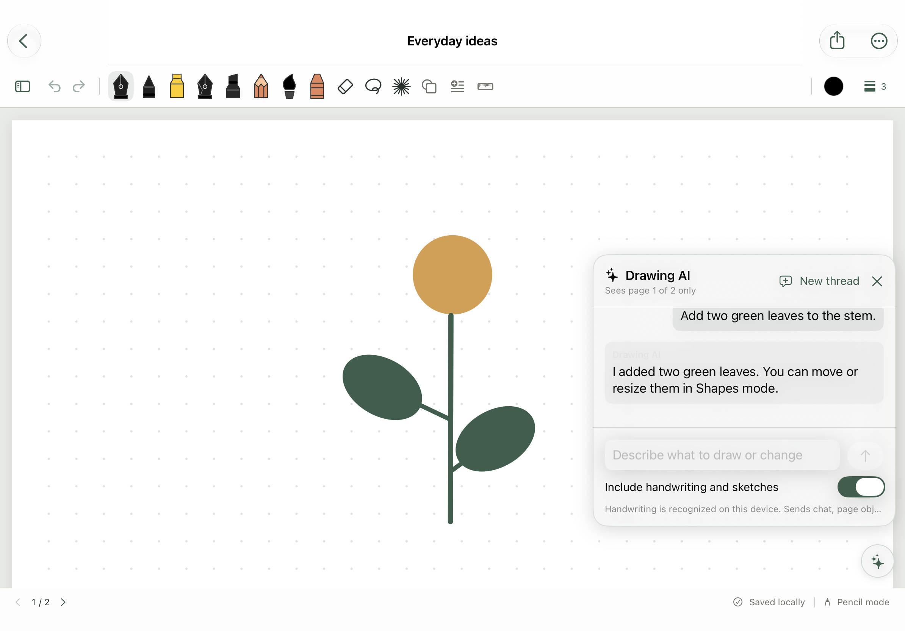

# DrawBook

**A quiet place to write, sketch, and think.**

DrawBook is a free, open-source notebook for iPad and iPhone. Write with a compatible stylus, sketch with native brushes, annotate PDFs, and keep your notebooks on your device. Built with SwiftUI, PencilKit, and PDFKit.

**MIT licensed · Offline notebooks · No DrawBook account · No ads · No third-party dependencies**

## Screenshots

Native iPad simulator screenshots with fictional sample notebooks.





## What you can do

- Organize notebooks with five cover colors, title search, recent sorting, rename, and duplication.
- Write on blank, ruled, grid, or dotted paper, with multiple pages per notebook.
- Use ballpoint, monoline, highlighter, fountain pen, pencil, watercolor, and crayon brushes. Reed pen is available on iPadOS 26 or later.
- Adjust each pen's color and width; erase with a variable-size rubber; use lasso and ruler.
- Add editable rectangles, ellipses, triangles, lines, and arrows. Move, resize, rotate, fill, duplicate, and partially erase shapes.
- Use **Add Text** for typed labels and multiline notes. Select a text box in Shapes mode to edit its contents, color, or font size.
- Use optional **Drawing AI** to read handwriting, add sketches or text, and edit the current page.
- Point with a temporary red laser that disappears after three seconds and never enters saved notes or exports.
- Undo and redo on the current page, pinch to zoom, and drag to move the page (one finger in Pencil mode, two with Touch drawing). Drag beyond a page edge to turn pages.
- Import PDFs, export a page as PNG or a notebook as PDF, and export/restore editable backups.
- Save automatically, with visible save errors and retry controls.

## Get started

### Requirements

- A Mac with **Xcode 26 or later** and the iOS platform installed. Use a version that supports your device's OS. This project uses the iOS 26 PencilKit SDK while supporting devices running **iOS/iPadOS 17 or later**.
- An iPad or iPhone, or an installed iOS simulator.
- For installation on a physical device, your own Apple signing team and a unique Bundle Identifier. No Apple Account is needed for simulator builds.

### Build and run

1. Open **`DrawBook.xcodeproj`** in Xcode. No package installation or project generation is required.
2. Choose the **DrawBook** scheme and an iPad simulator, then press **⌘R**.
3. For a real device, select the **DrawBook target → Signing & Capabilities**, choose your own team, and set a unique Bundle Identifier such as `com.yourname.drawbook`.
4. Connect and trust your device, enable [Developer Mode](https://developer.apple.com/documentation/xcode/enabling-developer-mode-on-a-device), choose it as the run destination, and press **⌘R**.

A free Apple Account can be used for personal device testing; free provisioning expires and requires periodic rebuilding. See [Apple's current membership and Personal Team limitations](https://developer.apple.com/help/account/membership/compare-memberships). The source code is free; Apple's signing and distribution requirements are separate.

**Updating an existing installation:** keep its original team and Bundle Identifier, and install over the app. Export editable backups first. The default `com.local.papernest` identifier, private `PaperNest` storage directory, and `.papernest` backup format are intentionally retained from earlier development builds so a display-name change does not strand existing notebooks. New users should choose their own Bundle Identifier.

### Your first notebook

1. Choose **New notebook**, give it a title, and select a cover and paper style.
2. Write with a stylus recognized by iPadOS. For a mouse, finger, or touch-based stylus, enable **Touch drawing** in the page menu.
3. Choose a pen, then tap the color circle or size control to adjust it.
4. Use **Show pages** for page thumbnails and the page menu to add pages or change paper.
5. Use **Share → Editable notebook backup** regularly to protect your work.

Pressure, tilt, buttons, and palm rejection depend on your hardware. Touch drawing provides less palm rejection than Pencil mode.

## Drawing AI

Drawing AI requires an internet connection, an API key for OpenRouter, Ollama Cloud, Claude (Anthropic), or OpenAI, and a model that supports tool calling. Notebook editing works offline.

1. In the library, open **AI configuration** in the sidebar, select **OpenRouter**, **Ollama Cloud**, **Claude**, or **OpenAI**, enter that provider’s API key, and save. Default models: OpenRouter `openrouter/free`, Ollama Cloud `gpt-oss:120b`, Claude `claude-opus-5-5`, OpenAI `gpt-5`. Each provider has its own settings. Clear the active provider’s key and save to disable Drawing AI.
2. Open a notebook and tap **Drawing AI** (the sparkles at the bottom right of the page). Try “Write ‘Project plan’ at the top,” “Draw an airplane in the top right,” or “Write ‘Buy milk’ with my pencil.” Drawing AI can create editable shapes and paths, typed text boxes, and PencilKit ink using the current brush, color, and width.
3. To target a specific shape, path, or text box, select it in Shapes mode before opening Drawing AI. Try “Move this to the left” or “Delete this.”
4. Use **New thread** to clear the conversation and keep the page edits. One **Undo** reverses all page edits from a completed AI turn, including changes to objects and ink.



The iPad simulator preview shows the chat panel over the editor with a fictional conversation. The capture runs locally without contacting an AI provider.

**What gets shared.** When you tap **Send**, DrawBook sends your prompt, recent conversation, editable objects on the current page, and any tool results to the selected provider. The system prompt carries only a short page summary; the agent reads the full page with `get_page_state` when it needs it, which shares simplified stroke data and text recognized on your device by Apple Vision, so Drawing AI can read handwriting and edit ink by line, word, or stroke. It changes the page with `apply_patch` and empties it with `clear_page`. Provider API keys are stored in Keychain.

**Page images.** **Send Page as Image to AI** is off by default and saved separately per provider. If you enable it for a model with vision, the agent can request a 768 × 1024 JPEG of the current page with an optional coordinate grid. The image includes the paper, any imported PDF background, and editable objects. The image also includes your handwriting and sketches. Requests include up to two recent page images from the current turn. DrawBook drops the images from conversation history.

**How edits work.** Drawing AI receives the current page as JSON, can reread its working copy with `get_page_state`, and proposes changes through `apply_patch` (RFC 6902 JSON Patch). DrawBook validates each patch and returns errors the model can use to revise its changes. At the end of the turn, DrawBook applies the changes as one edit.

## Backups, exports, and privacy

| Format | Use | Editable ink and shapes? |
| --- | --- | --- |
| `.papernest` | Complete notebook backup and restore | Yes |
| PDF | Share the entire notebook | No; ink is flattened |
| PNG | Share the current page at 1536 × 2048 | No |

Use **Import PDF or backup** in the library to restore a backup. Restoration creates a separate notebook and leaves the original unchanged. PDFs must be unlocked and no larger than 200 pages / 250 MB. Editable backups have a 500 MB limit.

Notebook files stay in the app's private local storage and use atomic writes and iOS file protection. Corrupt ink is preserved rather than silently overwritten. DrawBook has no telemetry, advertising, or automatic cloud sync. You can share files through the system share sheet or send drawing data through the optional Drawing AI chat.

DrawBook runs without a developer-operated backend. Optional AI requests go directly to your chosen provider, whose data handling and retention policies apply. [DrawBook Privacy Policy](docs/PRIVACY.md)

**Keep your own backups.** The notebook directory is excluded from automatic device/iCloud backup. Deleting the app, losing the device, or changing signing identity can make notebooks unavailable. Save important editable backups to Files, an external drive, or another destination you trust. Share exports temporarily remain in the app's sandbox until system cleanup.

## Development and verification

```sh
# Validate project references, assets, plists, and Swift syntax.
./scripts/check-project.sh

# Compile an unsigned iOS simulator build.
./scripts/check-project.sh --build

# Run XCTest on an installed simulator (choose one from -showdestinations).
xcodebuild -project DrawBook.xcodeproj -scheme DrawBook -showdestinations
DRAWBOOK_TEST_DESTINATION='platform=iOS Simulator,name=iPad (A16)' \
  ./scripts/check-project.sh --test

# Scan only the intended public source, with redacted findings.
python3 scripts/check-release.py

# Create a staged, rescanned source archive in build/release/.
./scripts/package-source.sh
```

If Xcode is not selected, prefix a command with `DEVELOPER_DIR=/Applications/Xcode.app/Contents/Developer`. Build output stays in ignored `build/` directories. See [the verification report](docs/VERIFICATION.md) for the checks actually completed and remaining hardware checks.

The XCTest suite covers persistence, failed-write recovery, malformed imports, corruption checks, backups, PDF backgrounds, shape editing, erasure, undo/redo, page navigation, laser expiry, export rendering, handwriting recognition, AI page state and patch validation, and provider request and response handling.

### Known limits

- This is a source distribution, not an App Store download or a signed installable IPA.
- Pages use a fixed 768 × 1024 document canvas. Imported PDFs keep their proportions, with margins where needed.
- Undo history lasts while a page is open. PNG and PDF exports cannot restore editable ink.
- No library-wide text/OCR search, cloud sync, audio recording, or collaboration. Handwriting recognition runs on-device only for the page you ask Drawing AI about.
- Physical stylus accuracy, palm rejection, and fast erasing require testing on your own iPad.

## Project map

| Location | Purpose |
| --- | --- |
| `DrawBook/LibraryView.swift` | Library, creation, imports, and help |
| `DrawBook/NotebookEditor.swift` | Page navigation, saving, and sharing |
| `DrawBook/DrawingCanvas.swift` | PencilKit input, erasing, zoom, and undo |
| `DrawBook/ToolControls.swift` | Drawing tools and style controls |
| `DrawBook/NotebookStore.swift` | Local persistence, validation, backup/restore |
| `DrawBook/PageRenderer.swift` | Paper, PDF backgrounds, and exports |
| `DrawBook/ShapeRenderer.swift` | Editable shape geometry and rendering |
| `DrawBook/DrawingAIChat.swift` and `DrawBook/AISettings.swift` | Drawing AI chat and provider configuration |
| `DrawBook/AIPageState.swift`, `DrawBook/AIJSONPatch.swift`, and `DrawBook/AIHandwriting.swift` | AI page tools, patch validation, and on-device handwriting recognition |
| `DrawBook/AIClient.swift` | Provider requests and tool calls (OpenAI-compatible for OpenRouter, Claude, and OpenAI; native API for Ollama Cloud) |
| `DrawBookTests/` | XCTest regression coverage |
| `scripts/` | Build checks and safe source packaging |

## Contributing and security

See [CONTRIBUTING.md](CONTRIBUTING.md) for development guidance and [SECURITY.md](SECURITY.md) for privacy and reporting guidance. Publish the source archive produced by the packaging script; do not upload the entire working folder, which can contain personal Xcode state and signed build products.

## License and name

[MIT License](LICENSE). Free to use, modify, share, and use commercially, subject to retaining the copyright and license notice. Provided without warranty. Apple's frameworks and tools remain subject to Apple's terms.

DrawBook is the chosen project name; **it is not claimed to be unique or reserved**. This project is independent of other similarly named products. No trademark clearance or App Store name reservation is implied.
